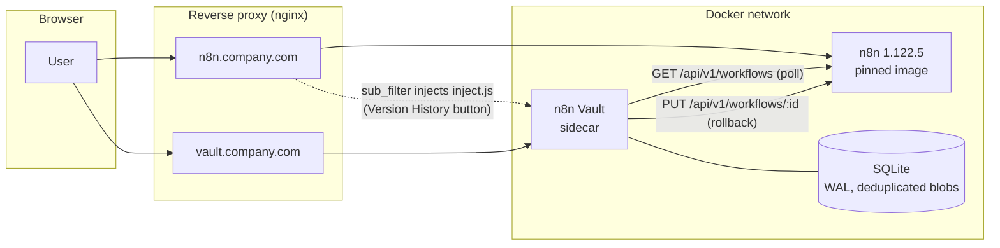
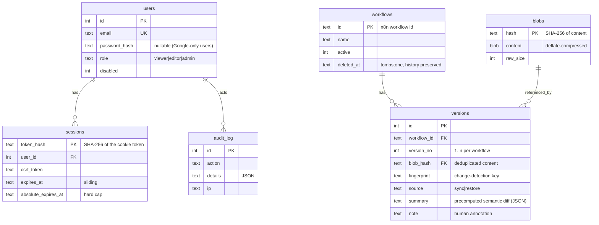
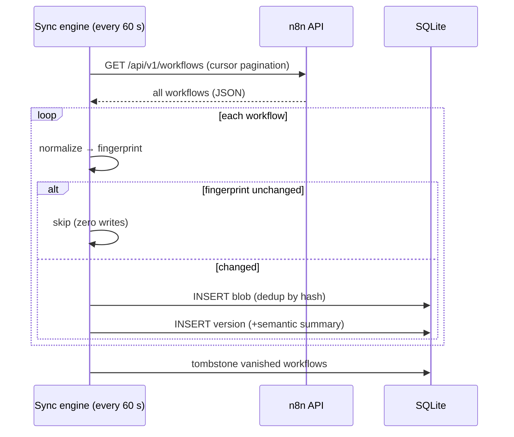
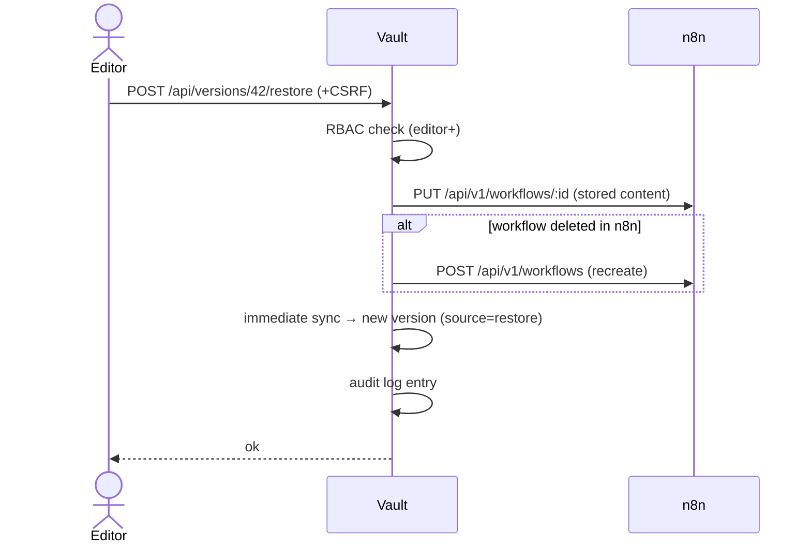

# n8n Vault — Architecture & Design Document

Enterprise-grade version history for self-hosted n8n (v1.122.5), designed to feel like a
native extension of n8n while surviving n8n upgrades untouched.

---

## 1. System architecture

n8n Vault is a **sidecar service**: a single, self-contained container deployed next to n8n.
It talks to n8n exclusively through the **public REST API** (`/api/v1`) — the only interface
n8n guarantees to keep stable across releases.



### Why this architecture beats the alternatives

| Alternative | Why it was rejected |
|---|---|
| **Fork of the n8n UI** | Must be rebased and rebuilt on every n8n release — the exact maintenance burden the project must avoid. A fork also forks the security surface: you become responsible for patching n8n's frontend yourself. |
| **Community node inside n8n** | Runs inside n8n's process and lifecycle; breaks on major internal refactors; cannot enforce its own authentication perimeter; no place to host a real UI. |
| **Direct DB access to n8n's database** | n8n's schema is internal and changes between versions — the opposite of upgrade-safe. |
| **Git/GitHub as the only backend** | Great for off-site copies, but per-version metadata (notes, authors, audit, RBAC) and instant semantic diffs fit a database better. A Git mirror remains a good *addition* (see Future improvements). |
| **Heavier stack (Postgres, Redis, SPA framework)** | For the write volume involved (a workflow edit every few minutes at worst), SQLite in WAL mode is faster than a networked database and removes two containers of operational overhead. Zero build step keeps the UI auditable. |

**Chosen:** Node.js sidecar + SQLite + vanilla-JS UI + proxy-injected editor button.
It optimizes exactly what was asked: security (own perimeter), simplicity (one container,
one volume), upgrade-resilience (public API only), and minimal operational overhead.

### Upgrade path (your stated requirement)

Upgrading n8n = changing one pinned tag in `docker-compose.yml`
(`n8nio/n8n:1.122.5` → `n8nio/n8n:1.x.y`). Vault requires **zero changes**: the public API
contract it uses (list workflows, update workflow) is stable. The injected button reads only
the URL path (`/workflow/:id`), which n8n has kept stable for years; if it ever changed, the
only symptom would be a missing button — never a broken n8n.

---

## 2. Technology stack

| Layer | Choice | Rationale |
|---|---|---|
| Runtime | Node.js 20 LTS | Same ecosystem as n8n; native `fetch`; long support window. |
| Web framework | Express 4 | Boring, audited, universally understood. |
| Storage | SQLite (better-sqlite3, WAL) | Zero-ops, transactional, faster than networked DBs at this scale; one file to back up. |
| Passwords | bcryptjs (cost 12) | Standard adaptive hashing. |
| Frontend | Vanilla JS + hand-written CSS | No build step, no supply-chain exposure, instant loads, trivially auditable. Visual language matches the n8n editor. |
| Packaging | Docker (non-root user, healthcheck) | Single artifact; drops into the existing compose stack. |

Total production dependencies: **3** (express, better-sqlite3, bcryptjs). This is a
deliberate security and maintainability decision — the entire dependency tree can be reviewed
in an afternoon.

---

## 3. Security architecture

Defense in depth, outermost to innermost:

1. **Network**: Vault sits behind the reverse proxy with TLS. n8n and Vault talk over the
   private Docker network; neither database port is ever exposed.
2. **Authentication**: no page or API responds without a valid session. Anonymous requests
   to `/` redirect to `/login`; anonymous API calls get `401`.
3. **Sessions**: 256-bit random tokens; only the SHA-256 hash is stored server-side (a DB
   leak leaks no usable tokens). Cookies are `HttpOnly` + `SameSite=Lax` (+ `Secure` on
   HTTPS). Sliding expiration (default 8 h) with an absolute cap (default 7 days).
4. **CSRF**: double-submit token bound to the session, required on every mutating call —
   defense in depth on top of SameSite.
5. **Rate limiting**: login attempts limited per IP+email (8 per 10 minutes).
6. **RBAC** (see §5).
7. **Headers**: strict `Content-Security-Policy`, `X-Frame-Options: DENY`,
   `X-Content-Type-Options: nosniff`, `Referrer-Policy: same-origin`.
8. **Secrets hygiene**: n8n credentials never enter Vault. Workflow `pinData` (which can
   contain real production payloads) and `staticData` are stripped **before** storage.
9. **Audit log**: every login, failed login, denial, sync, restore, note and user change is
   recorded with actor, IP and timestamp (admin-visible, pruned after a configurable window).
10. **Container**: runs as non-root, no shell tools needed at runtime.

### 4. Authentication strategy

- **Primary: email + password** (bcrypt, admin-provisioned accounts). Always available,
  works offline, no external dependency.
- **Optional: Google Workspace (OIDC authorization-code flow)** — enable by setting
  `GOOGLE_CLIENT_ID` / `GOOGLE_CLIENT_SECRET`. Access is restricted to pre-created users, or
  auto-provisioned as *viewer* when the account belongs to `GOOGLE_ALLOWED_DOMAIN`. The flow
  uses a server-side `state` nonce; the ID token is received directly from Google over TLS in
  a client-secret-authenticated exchange, and `aud` + `email_verified` are checked.
- SAML was considered and deferred: it adds a heavy dependency for no gain at this org size;
  OIDC covers Google Workspace, which is the stated environment.

### 5. Authorization model (RBAC)

| Capability | viewer | editor | admin |
|---|---|---|---|
| Browse workflows, versions, diffs | ✔ | ✔ | ✔ |
| Download version JSON | ✔ | ✔ | ✔ |
| Trigger sync, add notes | | ✔ | ✔ |
| **Restore (rollback) to n8n** | | ✔ | ✔ |
| Manage users, view audit log | | | ✔ |

Safety rails: an admin cannot demote or disable their own account; disabling a user kills
their active sessions immediately.

---

## 6. Database design



**Storage optimization:** versions never duplicate content. Content lives in `blobs`, keyed
by SHA-256 and deflate-compressed (~85–90 % smaller than raw JSON). If a rollback recreates
a byte-identical state, the new version row points to the *existing* blob. Unchanged
workflows write nothing at all.

---

## 7. API design

All endpoints are JSON, require a session, and mutating calls require the CSRF header.

```
GET    /api/me                        session, role, sync status
GET    /api/workflows?q=              list + latest-version metadata
GET    /api/workflows/:id/versions    version timeline
GET    /api/versions/:vid             one version incl. full content
GET    /api/versions/:vid/diff        semantic + line diff vs predecessor (?against=)
POST   /api/workflows/:id/commit      explicit per-workflow save with note (editor+)
PATCH  /api/versions/:vid/note        annotate a version            (editor+)
POST   /api/sync                      sync on demand                (editor+)
POST   /api/versions/:vid/restore     rollback to n8n               (editor+)
GET    /api/users                     user management               (admin)
POST   /api/users · PATCH /api/users/:id                            (admin)
GET    /api/audit                     audit trail                   (admin)
```

Errors are always `{ "error": "human-readable English message" }` with a correct status
code (`401`, `403`, `404`, `409`, `429`, `502`).

---

## 8–9. Synchronization strategy & version detection algorithm

**Detection = content fingerprinting** (chosen over timestamps, which lie: n8n touches
`updatedAt` on activation toggles and other non-edits, and timestamps say nothing about
*what* changed).

Two entry points share the same engine:

- **Explicit save** (`POST /api/workflows/:id/commit`) — the "Save version" button in the
  n8n editor. Reads that single workflow from n8n, and creates a version *only if it
  changed*, carrying the author and their note. This is the intended everyday flow.
- **Automatic sweep** (every `SYNC_INTERVAL_SECONDS`) — the safety net that catches
  anything nobody saved explicitly, plus deletions.

Every `SYNC_INTERVAL_SECONDS` (default 60), and on demand:

```
1. GET /api/v1/workflows (paginated, pinned data excluded)
2. For each workflow:
   a. NORMALIZE  — keep only meaningful fields (id, name, active, isArchived,
                   nodes, connections, settings, tags); drop noise & risk
                   (updatedAt, versionId, triggerCount, pinData, staticData, meta);
                   sort all object keys recursively → canonical JSON text
   b. FINGERPRINT — SHA-256 of the canonical text
   c. COMPARE     — fingerprint == latest stored version?  → skip (no write)
   d. STORE       — otherwise: dedup-insert blob, insert version row with a
                    precomputed semantic summary vs the previous version
3. Tombstone workflows that disappeared from n8n (history preserved)
```

The whole persist step is a single SQLite transaction: a crash mid-sync can never produce a
half-written version. Concurrent runs are prevented with an in-process lock. This satisfies
the core requirement literally: **unchanged workflows are never uploaded, stored, or even
written to disk.**



## 10. Diff generation strategy

Two complementary layers, both computed from normalized content:

- **Semantic diff (default view)** — speaks n8n's language: nodes added / removed /
  modified (with the exact `parameters.*` keys that changed), nodes merely moved
  (flagged "Layout only" so cosmetic drags don't look like logic changes), connection
  re-wiring, settings, rename, activation, tags. Precomputed at sync time and stored with
  the version, so timelines render instantly.
- **Raw line diff (one click deeper)** — LCS-based unified diff of the canonical JSON with
  3 lines of context, computed on demand. Because the text is canonical (sorted keys,
  stable indentation), a one-parameter edit produces a one-line diff.

## 11. Rollback implementation

`POST /api/versions/:vid/restore` (editor+):

1. Load the stored normalized content of that version.
2. `PUT /api/v1/workflows/:id` with exactly the fields n8n's update endpoint accepts
   (`name`, `nodes`, `connections`, `settings`).
3. If n8n answers 404 (workflow deleted there), `POST /api/v1/workflows` recreates it.
4. An immediate sync captures the restored state as a **new version** marked `restore` —
   history is append-only; a rollback never rewrites it, so a rollback can itself be
   rolled back.
5. Audit entry with actor, workflow, version and outcome.



---

## 12–13. Deployment & Docker architecture

One `docker-compose.yml`, three concerns:

- **n8n** — image tag **pinned** (`n8nio/n8n:1.122.5`). Upgrading the instance is a
  deliberate, git-auditable edit of this file, which also answers your original
  instance-versioning question: keep the compose file in a small infra repo, and `git log`
  tells you who upgraded n8n, when, and from which version.
- **vault** — built from this repo; non-root; healthcheck; single `vault_data` volume
  (the SQLite file — that volume *is* the backup surface).
- **nginx** (your existing proxy) — TLS for both hostnames + the one-line `sub_filter`
  that injects the Version History button into the editor.

Folder structure:

```
n8n-vault/
├── docker-compose.yml      n8n (pinned) + vault
├── Dockerfile              non-root, healthcheck
├── package.json            3 runtime dependencies
├── src/
│   ├── server.js           Express app, routes, security headers
│   ├── config.js           env-driven configuration
│   ├── db.js               schema, blob dedup+compression, audit
│   ├── auth.js             sessions, RBAC, CSRF, rate limit, Google OIDC
│   ├── sync.js             change-detection engine + scheduler
│   ├── diff.js             normalization, fingerprint, semantic & line diff
│   └── n8nClient.js        the ONLY n8n coupling point (public API)
├── public/                 login + app UI (vanilla JS, no build step)
├── inject/inject.js        "Version History" button for the n8n editor
├── nginx/n8n-proxy.conf    proxy + injection snippet
└── test/                   mock n8n + 25-check e2e suite + UI screenshots
```

---

## 19–20. Performance & scalability

- Unchanged workflows cost one in-memory hash comparison — no I/O.
- SQLite WAL: readers never block the sync writer; the UI stays snappy during syncs.
- Semantic summaries are precomputed once at sync time; timelines are pure reads.
- Line diffs are computed on demand with prefix/suffix trimming (the DP only runs on the
  changed region) and an upper bound with a safe fallback for pathological inputs.
- Content is deduplicated and compressed; 10,000 versions of typical workflows ≈ tens of MB.
- Practical envelope: hundreds of workflows, dozens of users on a single small container.
  If an org outgrows that (thousands of workflows, many instances), the storage layer is the
  only thing to swap (SQLite → Postgres) — the schema already fits.

## 22. Risk analysis

| Risk | Mitigation |
|---|---|
| n8n API unreachable | Sync fails soft; status surfaces in the top bar; audit-logged; next tick retries. Nothing is ever partially written (transaction). |
| Two edits within one poll interval | Only the latest lands as a version (poll granularity). Interval is configurable down to 15 s; acceptable trade-off vs. webhook complexity — noted in Future improvements. |
| Vault DB loss | One volume to back up (`vault_data`); n8n itself is unaffected either way. |
| Stolen session cookie | HttpOnly blocks JS theft; tokens stored hashed; absolute expiry caps exposure; admin can disable the user, killing sessions instantly. |
| Brute-force login | Rate limit + bcrypt cost 12 + audit trail of failures. |
| Malicious restore | Editor role required, CSRF-protected, audit-logged, and reversible (the pre-restore state is itself a version). |
| Secrets in history | Credentials never leave n8n (API returns references only); pinData/staticData stripped before storage. |

## 23. Trade-off analysis (the honest list)

- **Polling vs. webhooks**: polling every 60 s is simpler and survives n8n upgrades;
  sub-interval intermediate states are not captured. Chosen consciously.
- **SQLite vs. Postgres**: zero-ops wins at this scale; swap path documented.
- **No Git backend (yet)**: DB gives richer metadata and instant diffs; a Git/GitHub
  mirror is additive and listed below.
- **Author attribution**: n8n's public API does not expose *who* edited a workflow, so
  automatic versions cannot name the editor. Mitigated with notes and restore attribution.
  (n8n Enterprise's own source control has the same gap.)

## 24. Implementation roadmap

1. **Deploy** (½ day): create the n8n API key, set env vars, `docker compose up -d`,
   create user accounts, TLS on the proxy. → Working history + rollback.
2. **Editor button** (1 h): add the `sub_filter` snippet to nginx.
3. **Google Workspace SSO** (1–2 h): OAuth client in Google Cloud Console, two env vars.
4. **Backups** (1 h): nightly copy of the `vault_data` volume (single SQLite file).
5. **Adopt**: editors annotate meaningful versions with notes; admins review the audit log.

## 25. Future improvements

- GitHub mirror (push each new version to a repo for off-site history — reuses the
  commit-per-change design already prototyped for this project).
- Environment promotion (dev → QA → prod) with approval gates.
- Slack/email notifications on changes to tagged "production" workflows.
- Side-by-side visual (canvas) diff rendering of the two node graphs.
- Postgres storage driver behind the same schema, if scale ever demands it.
- Webhook-assisted sync (n8n workflow that POSTs to Vault on save) to shrink the
  detection window below the poll interval — additive, not required.
